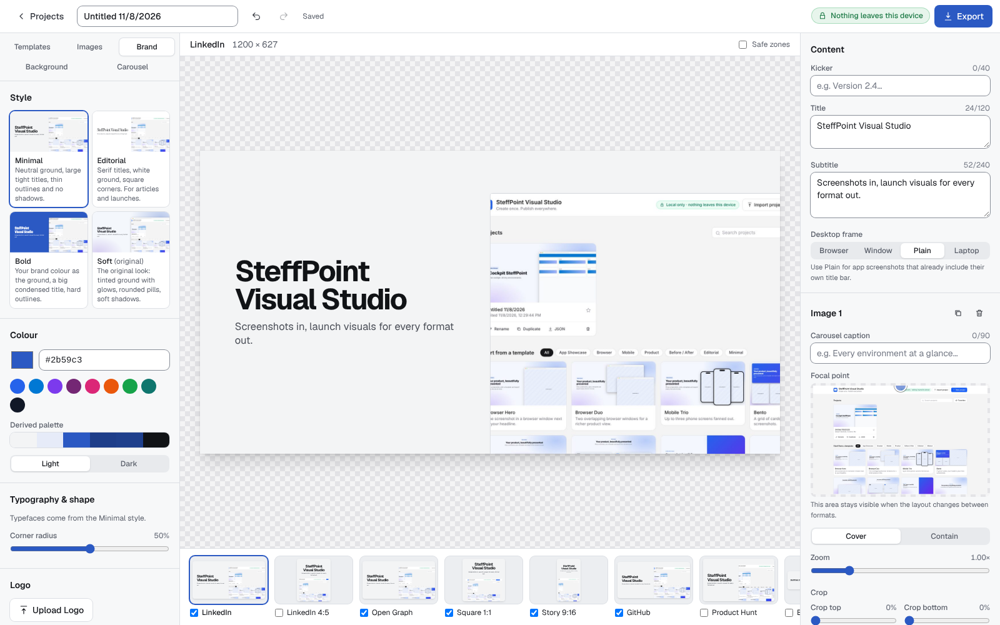
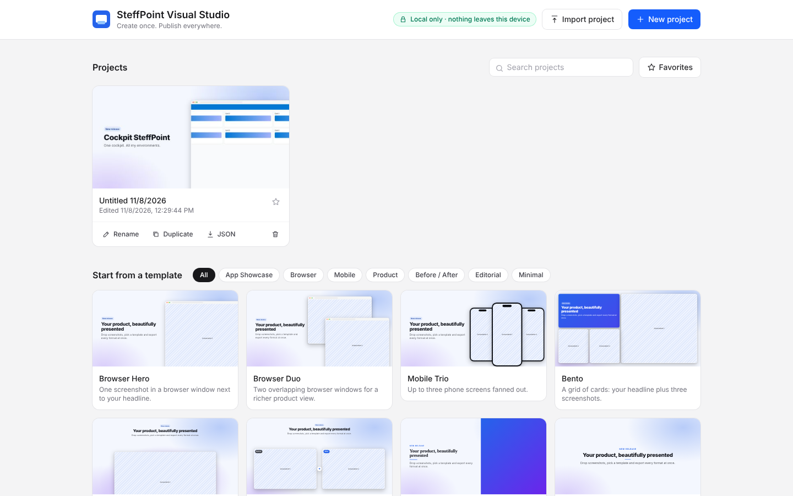
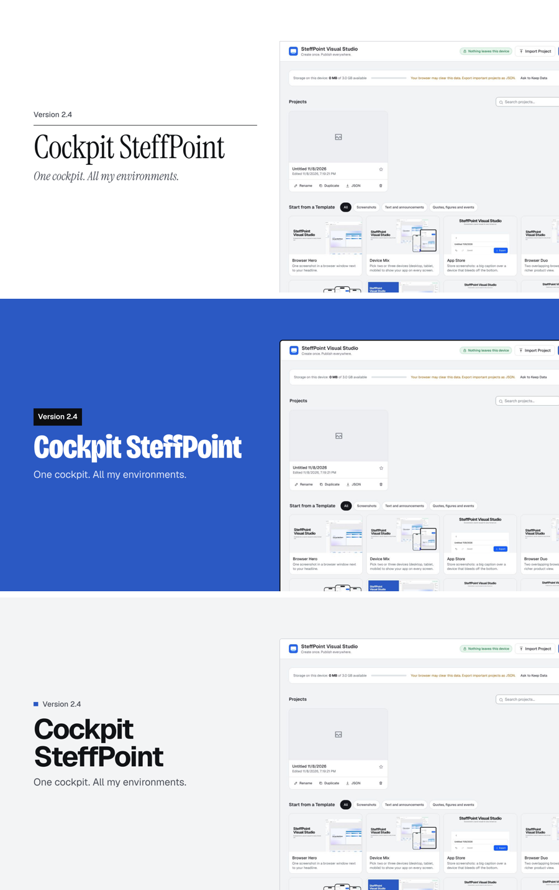
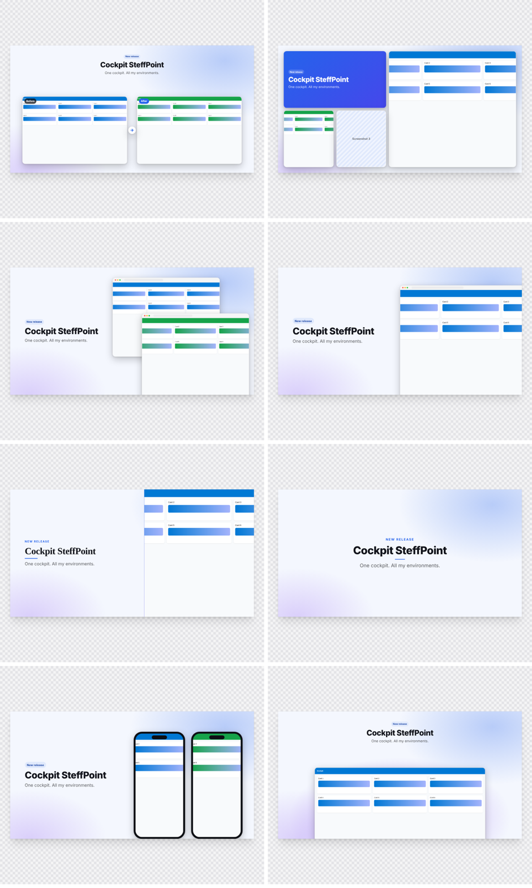
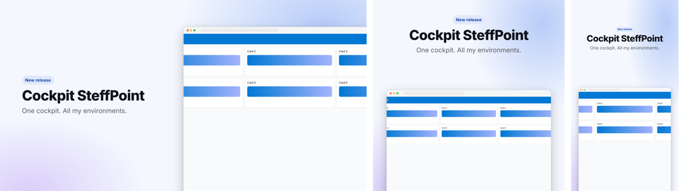

<div align="center">


# SteffPoint Visual Studio

**Create once. Publish everywhere.**

Turn screenshots, a logo and a headline into a consistent pack of social and product visuals in minutes, without being a designer.
Runs entirely in your browser: **your images never leave your device.**

[](https://github.com/ostefnn/SteffPoint-Visual-Studio/actions/workflows/pages.yml)
[](LICENSE)


**[▶ Open the app](https://ostefnn.github.io/SteffPoint-Visual-Studio/)**

</div>



---

## Table of contents

- [Why](#why)
- [Features](#features)
- [Templates](#templates)
- [Output formats](#output-formats)
- [How to use](#how-to-use)
- [Keyboard shortcuts](#keyboard-shortcuts)
- [Getting started (development)](#getting-started-development)
- [Deployment](#deployment)
- [Project file format](#project-file-format)
- [Architecture](#architecture)
- [Privacy & security](#privacy--security)
- [Roadmap](#roadmap)
- [Contributing](#contributing)
- [License & credits](#license--credits)

## Why

Publishing a new app or feature means producing the same visual again and again: a LinkedIn post, an Open Graph image, a square, a story, a GitHub social preview… SteffPoint Visual Studio lets you compose **one** visual and get **all** formats, consistently branded, in a single export.

It is deliberately **not** Canva, Figma or Photoshop. It is a guided, focused tool:

> Import → compose → adapt → export

## Features

| | |
|---|---|
| 🗂️ **Projects** | Create, rename, duplicate, delete, favourite, search. Automatic thumbnails. Autosave. |
| 💾 **Local storage** | Projects, images and thumbnails stored in IndexedDB. Close the tab, come back later, everything is there. |
| 🧩 **16 templates** | Browser Hero, Device Mix, App Store, Browser Duo, Mobile Trio, Bento, Spotlight, Before / After, Testimonial, Key Figures, Event, Features, Code, Annotated Panel, Editorial, Minimal. |
| 🖼️ **Screenshots** | Up to 4 per project. Add by click, drag & drop anywhere, or paste (Ctrl/Cmd+V). Desktop screenshots can sit in a browser, a macOS window, no frame, or a laptop. |
| 🎯 **Crop & focal point** | Crop each edge, cover / contain, zoom in or out (0.5×–3×), and a focal point that stays visible when the layout changes between landscape, square and portrait. |
| ✒️ **Styles** | One click sets typefaces, title scale, kicker, frames, shadows and background for every template: **Minimal** (default), **Editorial**, **Bold**, or **Soft** (the original look, kept as an option). Fonts are bundled, so exports look the same on every computer. |
| 🎨 **Brand** | One primary colour → derived palette (accents stay in your brand's hue outside Soft). Light / dark theme, corner radius, logo (small / medium / large); heading font and shadow in Soft. Importing a logo samples its dominant colours on a canvas: the main brand colour becomes the primary (one undo step), the others are offered as one-click swatches. |
| 🌈 **Backgrounds** | Solid, gradient, soft glow, grid, mesh, with intensity and angle. |
| 📐 **Multi-format preview** | Every format previewed live, side by side. |
| 🔲 **Compare Styles** | A matrix on the canvas renders the same content in every style at the current format, laid out so each is drawn as large as possible; click one to apply it. |
| 🛟 **Safe zones** | Overlay showing where platform UI may cover your visual (e.g. stories, profile banners). |
| ↩️ **Undo / redo** | Bounded history (60 steps); rapid edits like typing or sliders are merged into one step. |
| 📦 **Export** | PNG, JPEG or WebP at 1×, 2× or 3×. One image, or a ZIP with every selected format plus `project.json`. |
| 🗂️ **LinkedIn carousel** | A 4:5 multi-page PDF for a LinkedIn document post. Automatic pages (cover, one per screenshot, features), or your own: a template per page, page-specific kicker/title/subtitle and screenshots, add, duplicate, reorder (drag, buttons or Alt+↑/↓). Up to 12 pages, with carousel-specific advice. |
| 💡 **Smart suggestions** | Deterministic checks, no AI: title length, WCAG AA contrast, legibility in feeds, wrong template or device for the screenshot orientation, images or logo too small for the export size, missing quote author, figures or event date. Informative only, never blocks export. |
| 🔁 **Import / export JSON** | Portable project file with images embedded. Backup, move between browsers, share. |



## Styles



| Style | Typefaces | Ground | Kicker | Screenshots |
|---|---|---|---|---|
| **Minimal** (default) | Geist | Neutral grey | Plain text with a brand square | Thin outline, no shadow |
| **Editorial** | Instrument Serif titles, Geist body, italic serif subtitle | White | Plain text over a hairline | Square corners, no shadow |
| **Bold** | Bricolage Grotesque, condensed | Your brand colour | Black label | Thick outline, hard offset shadow |
| **Technical** | Geist titles, Geist Mono kicker | White (or near-black) drafting grid | `// text` in mono, brand-coloured slashes | Window frame, square corners, hairline |
| **Tint** | Geist | Light tint of your brand; text in a dark shade of it | Plain text with a brand square | Window frame on a soft brand-coloured mat, no shadow |
| **Soft** | Inter / system, your heading font | Tinted with glows | Pill | Browser chrome, soft shadow |

Projects created before styles existed open in **Soft**, unchanged. Picking a style also applies its background and screenshot frame; both stay editable. No style uses tracked capitals or invented content: template defaults are placeholders that ask for your real quote, figures and event details.

## Templates



| Template | Best for | Screenshots |
|---|---|---|
| **Browser Hero** | Web app launch, one key screen | 1 |
| **Device Mix** | Responsive apps: pick 2 or 3 devices among desktop, tablet and mobile; tablet and phone can be portrait or landscape | 2–3 (one per device, in that order) |
| **App Store** | Store screenshots: big caption over a device that bleeds off the bottom (phone, tablet or desktop, picked from the format) | 1 |
| **Browser Duo** | Showing two related screens | 2 |
| **Mobile Trio** | Mobile apps | 1–3 |
| **Bento** | Feature overview | 1–3 |
| **Spotlight** | One hero screenshot with a brand glow | 1 |
| **Before / After** | Redesigns, SharePoint/SPFx makeovers, UX improvements | 2 |
| **Testimonial** | Customer quote with photo (or initials), name and role | 0–1 (photo) |
| **Key Figures** | 2–4 big numbers: users, ratings, time saved | 0 |
| **Event** | Webinars, meetups, launches: date, time, place, speakers and a call to action | 0–3 (speaker photos) |
| **Features** | “What’s new”, release notes, feature highlights (up to 4 items) | 0 |
| **Code** | Code snippet in an editor window, with light syntax colouring | 0 |
| **Annotated Panel** | A settings panel (or any UI) with numbered call-outs, next to its legend: field name, property, greyed when disabled. Import a capture report to get one page per group | 1 |
| **Editorial** | Articles, announcements, blog covers | 0–1 |
| **Minimal** | Text-only announcements | 0 |

Every template adapts its layout to landscape, square, portrait and very wide (banner) formats.

## Output formats



| Preset | Size (1×) | Notes |
|---|---|---|
| LinkedIn | 1200 × 627 | Feed post |
| LinkedIn 4:5 | 1080 × 1350 | Portrait post; page size of the LinkedIn carousel PDF |
| Open Graph | 1200 × 630 | Link previews; some platforms crop to the centre |
| Square 1:1 | 1080 × 1080 | Instagram, LinkedIn, etc. |
| Story 9:16 | 1080 × 1920 | Top and bottom covered by app UI |
| GitHub | 1280 × 640 | Repository social preview |
| Product Hunt | 1270 × 760 | Gallery image |
| Banner | 1584 × 396 | Profile banner; avatar covers bottom-left |
| Thumbnail 16:9 | 1280 × 720 | Video / article thumbnail |
| App Store iPhone | 1320 × 2868 | iPhone 6.9" store screenshot (export at 1×) |
| App Store iPad | 2064 × 2752 | iPad 13" store screenshot (export at 1×) |
| Mac App Store | 2880 × 1800 | Mac store screenshot (export at 1×) |
| Custom | 64 – 4096 px | Any size |

At 2× and 3× the pixel size is multiplied. Very large exports (> ~33 MP) show a warning.

## How to use

1. **New project** from the dashboard, or click a template to start from it.
2. **Images** tab: add 1 to 4 screenshots (click, drop or paste).
3. **Content** panel (right): kicker, title, subtitle, plus the fields of the current template (quote and author, figures, event details, devices and their orientation, desktop frame).
4. **Templates** tab: pick a layout. Previews use your own screenshots.
5. **Brand** tab: pick a **style** first, then colour, theme, radius, logo and its size (heading font and shadow in Soft). Best logo file: a transparent PNG or WebP cropped tight, at least 512 × 512 px for an icon or 800 px wide for a wordmark.
6. **Background** tab: style and intensity.
7. Select a screenshot to **crop** its edges and set **zoom, fit and focal point** (click or drag on the image, or use arrow keys).
8. Check every format in the **bottom strip**; tick the ones to export. Turn on **Safe zones** if needed.
9. **Export** → choose file type and resolution → download the ZIP.
10. **LinkedIn carousel** (optional): open the **Carousel** tab. Pages are generated automatically (captions from the Image panel become page titles). Click **Customize Pages** to pick a template per page, give a page its own text or screenshots, add a closing page and reorder. Then in Export click **Export Carousel PDF** and post the file on LinkedIn as a document.

### Annotated guide from a legend file

Have screenshots of a settings panel with numbered badges and a Markdown report that names each field (for example a SharePoint property pane capture)? On the dashboard, click **Import Legend** and select the `.md` file **together with its images**. Each `## Group (image.png)` section followed by a `| N° | Field | Property | State |` table becomes one screenshot with its caption and legend; the carousel becomes a guide: a title page (name, version), then one annotated page per group.

- Column names are recognised in English, French and Dutch (*Champ / Propriété / État*, *Veld / Eigenschap / Staat*); *Disabled*, *Désactivé* or *Uitgeschakeld* draws a hollow badge.
- Images named in the report but not selected are listed, never replaced by placeholders.
- Edit a legend later in the Image panel, one field per line: `Label | property | off`.
- Set the **brand colour** to the colour of the badges in your screenshots so the legend matches them.

Your work is saved automatically in the browser. Use **JSON** on a project card to back it up, and **Import project** to restore it.

> ℹ️ Data lives in the storage of the browser and site you use. Clearing site data deletes your projects; export JSON backups for anything important.
> The dashboard shows how much storage is used and whether the browser agreed to keep it ("persistent storage"). Browsers can clear non-persistent site data, for example after a long period without visits.

### Devices

| Device | Status |
|---|---|
| Desktop (Chrome, Edge, Firefox, Safari) | Full editor. Recommended. |
| iPad (landscape) | Full three-column editor. |
| iPad (portrait), iPhone | Stacked layout: preview, formats, then panels. Fine for edits and export; designed for quick changes rather than long sessions. |

On iPhone/iPad, very large exports (> 16.7 MP per image, e.g. Story at 3×) are blocked because Safari cannot render canvases that big. Exported ZIPs go to the Files app.

### Several tabs

The same project can be open in several tabs. A tab without unsaved changes follows the others automatically. If two tabs edit at the same time, the second one to save shows a conflict and lets you **load the latest version** or **keep yours**; nothing is overwritten silently.

## Keyboard shortcuts

| Keys | Action |
|---|---|
| Ctrl/Cmd + Z | Undo |
| Ctrl/Cmd + Shift + Z · Ctrl/Cmd + Y | Redo |
| Ctrl/Cmd + S | Save now |
| Ctrl/Cmd + D | Duplicate selected screenshot |
| Delete / Backspace | Remove selected screenshot |
| Ctrl/Cmd + V | Paste an image as a screenshot |
| Esc | Leave a field / deselect / close dialog |
| Arrow keys (focal point) | Move focal point (Shift = larger steps) |

## Getting started (development)

Requirements: **Node.js 20+** (22 recommended) and npm.

```bash
git clone https://github.com/ostefnn/SteffPoint-Visual-Studio.git
cd SteffPoint-Visual-Studio
npm install
npm run dev
```

Open http://localhost:5173.

| Script | Description |
|---|---|
| `npm run dev` | Start the dev server |
| `npm run build` | Typecheck and build to `apps/web/dist` |
| `npm run preview` | Serve the production build locally |
| `npm test` | Unit tests (`packages/visual-core`, Vitest) |
| `npm run e2e` | End-to-end tests (Playwright) on Chromium, Firefox, WebKit, iPhone and iPad emulation |
| `npm run typecheck` | TypeScript check of all workspaces |

## Deployment

The app is a fully static site: any static host works.

### GitHub Pages (included)

A workflow in [`.github/workflows/pages.yml`](.github/workflows/pages.yml) runs tests, builds and deploys on every push to `main` (or manually from the Actions tab).

One-time setup:

1. **Settings → Pages → Build and deployment → Source: _GitHub Actions_.**
2. Push to `main`. The site is published at `https://<owner>.github.io/<repo>/`.

The workflow sets `BASE_PATH=/<repo>/` so assets resolve under the project sub-path. Routing uses the URL hash (`#/p/<id>`), so reloads never 404.

> GitHub Pages on a **private** repository requires a paid GitHub plan.

### Other hosts

```bash
npm run build                                   # site at root, e.g. Netlify, Vercel, Cloudflare Pages
BASE_PATH=/some/sub/path/ npm run build         # site served under a sub-path
```

Publish `apps/web/dist`. No server configuration or rewrites are needed.

## Project file format

Exported `project.json` / `*.svs.json`:

```json
{
  "format": "steffpoint-visual-studio/project",
  "schemaVersion": "1.0",
  "exportedAt": "2026-11-08T12:00:00.000Z",
  "project": {
    "schemaVersion": "1.0",
    "name": "Cockpit SteffPoint Launch",
    "template": "device-mix",
    "content": {
      "kicker": "New release", "title": "Cockpit SteffPoint", "subtitle": "One cockpit. All my environments.",
      "quote": "…", "author": "…", "authorRole": "…",
      "stats": [{ "value": "10k+", "label": "Visuals exported" }],
      "eventDate": "…", "eventTime": "…", "eventPlace": "…", "cta": "…"
    },
    "brand": { "primary": "#0078d4", "theme": "light", "headingFont": "sans", "radius": 0.5, "shadow": 0.5, "logoAssetId": null, "logoSize": "medium" },
    "background": { "type": "glow", "intensity": 0.6, "angle": 135 },
    "assets": [{ "id": "ast_…", "name": "home.png", "mime": "image/png", "width": 1600, "height": 1000, "size": 123456 }],
    "screenshots": [{
      "id": "shot_…", "assetId": "ast_…", "fit": "cover", "zoom": 1, "focalX": 0.5, "focalY": 0,
      "crop": { "top": 0, "right": 0, "bottom": 0, "left": 0 }
    }],
    "exportPresets": ["linkedin", "open-graph", "square"],
    "carousel": {
      "pageNumbers": true,
      "slides": [
        { "id": "var_…", "template": "minimal", "content": { "title": "Too many tabs?" }, "screenshotIds": [] },
        { "id": "var_…", "template": "device-mix", "content": {}, "screenshotIds": null }
      ]
    },
    "customFormat": { "width": 1600, "height": 900 },
    "devices": ["desktop", "mobile"],
    "deviceOrientation": { "tablet": "portrait", "mobile": "portrait" },
    "desktopFrame": "browser"
  },
  "assets": { "ast_…": "data:image/png;base64,…" }
}
```

`schemaVersion` lets future versions migrate older files. Every import goes through `migrateProject()`, which drops unknown fields, clamps values, removes dangling references and fills newer fields with defaults, so files from earlier versions open unchanged. Projects that used the retired *Desktop + Mobile* template open as *Device Mix* with desktop and mobile.

In `carousel.slides`, each page is a **variant**: a template, optional `content` overrides (a missing `kicker`, `title` or `subtitle` uses the project's), and `screenshotIds` (`null` = the project's screenshots). An empty `slides` list means automatic pages.

## Architecture

```text
SteffPoint-Visual-Studio/
├── apps/
│   └── web/                     React 19 + Vite app
│       ├── public/              Static files (favicon)
│       └── src/
│           ├── components/      Dashboard, Editor, panels, export dialog, UI kit
│           ├── render/          Composition renderer: templates, frames, backgrounds
│           ├── lib/             IndexedDB, image import, exporter, Safari shadow fix, project file
│           └── store/           Zustand stores (editor + undo/redo, toasts)
├── packages/
│   └── visual-core/             Framework-free domain model (no DOM, no React)
│       └── src/
│           ├── formats.ts       Presets, safe zones, orientation
│           ├── templates.ts     Declarative template definitions (slots)
│           ├── color.ts         Palette derivation, WCAG contrast
│           ├── typography.ts    Shared type scale and font stacks
│           ├── project.ts       Project schema, defaults, validation, migration
│           ├── legend.ts        Annotated Panel legends: text form and Markdown report parser
│           ├── logoColors.ts    Dominant colour sampling for logos
│           └── rules.ts         Smart suggestions / accessibility checks
├── docs/
│   ├── vision.md                Full product vision (FR)
│   └── images/                  README screenshots
├── e2e/                         Playwright end-to-end tests + fixtures
├── .github/workflows/ci.yml     Tests on every pull request
├── .github/workflows/pages.yml  GitHub Pages deployment
├── LICENSE
├── THIRD_PARTY_NOTICES.md
└── README.md
```

**Rendering pipeline:** the `Composition` component is a pure function of *(project, width, height, image URLs)*. The editor shows it scaled down with a CSS transform. For export it is rendered off-screen at native size and rasterised with [modern-screenshot](https://github.com/qq15725/modern-screenshot), so preview and export are the same DOM. Safari and iOS browsers draw CSS box-shadows wrongly in that capture step (no blur, no rounded corners), so on WebKit the exporter first replaces them with stacked rounded layers (`lib/flattenShadows.ts`).

**Why `visual-core` is separate:** it can later power a render API, a batch generator or Microsoft 365 / SharePoint adapters without depending on the web UI.

**Stack:** TypeScript · React 19 · Vite · Tailwind CSS v4 · Zustand · idb (IndexedDB) · modern-screenshot · JSZip · Vitest · Playwright.

**CI:** every pull request runs unit tests, type checks and the E2E suite on Chromium, Firefox, WebKit and iPhone/iPad emulation. The export test opens the generated ZIP and checks image sizes and that the screenshot pixels are really present.
Vite was chosen over Next.js because the app is fully client-side with no server rendering.

## Privacy & security

- **Local-first.** Editing, rendering, thumbnails and ZIP creation run in the browser. The app makes no network requests besides loading itself.
- **Strict Content Security Policy** in production builds: no remote origins for scripts, images, fonts or connections.
- **File validation:** PNG, JPEG, WebP, GIF only, max 20 MB each, and the file must decode as an image.
- **Import sanitisation:** project files are normalised (types checked, values clamped, control characters removed); text is rendered by React, never as HTML.
- **Object URLs** are revoked when a project is closed. Unused image blobs are garbage-collected only when no tab has the project open (Web Locks).
- **Optimistic locking:** every save checks the stored `revision`, so a stale tab cannot overwrite newer work.

Found a security issue? Please open a private security advisory on GitHub rather than a public issue.

## Roadmap

**V1 — Better Cover Studio** (this release): projects, IndexedDB, autosave, JSON, 16 templates (including Device Mix, App Store, Testimonial, Key Figures, Event, Annotated Panel with legend import), device and laptop frames, App Store formats, crop/zoom/focal point, brand with logo size, undo/redo, safe zones, custom sizes, PNG/JPEG/WebP, ZIP export, LinkedIn carousel PDF.

**V2 — Visual Studio:** reusable Brand Kits, Asset Manager, variants beyond the carousel (Original / Dark / Minimal…, built on the same `Variant` model), more Before/After modes (split, slider), richer accessibility checks, FR / NL / EN interface.

**V3 — Visual Platform:** optional cloud sync and teams, batch generator (CSV/JSON), URL capture service, render API, CMS integrations, AI-assisted copy. Remote features will always be opt-in and clearly labelled.

Details in [`docs/vision.md`](docs/vision.md).

## Contributing

Issues and pull requests are welcome.

1. Fork and create a branch.
2. `npm install`, then `npm test && npm run typecheck && npm run build`.
3. Keep the product principle in mind: **a professional result in two minutes, without being a designer.** Prefer fewer, better options.
4. New templates: add the definition in `packages/visual-core/src/templates.ts` and the layout in `apps/web/src/render/Composition.tsx`, and make sure it looks right in landscape, square, portrait and banner formats.

## License & credits

Released under the [MIT License](LICENSE) © 2026 O. Steffen.

- Product concept inspired by [Cover Studio](https://github.com/roosveltkn/cover-studio) by roosveltkn (MIT). No Cover Studio code is currently included.
- Third-party packages and their licenses: [`THIRD_PARTY_NOTICES.md`](THIRD_PARTY_NOTICES.md).
- LinkedIn, GitHub, Product Hunt and other names are trademarks of their respective owners, used only to describe image sizes. No affiliation or endorsement.
